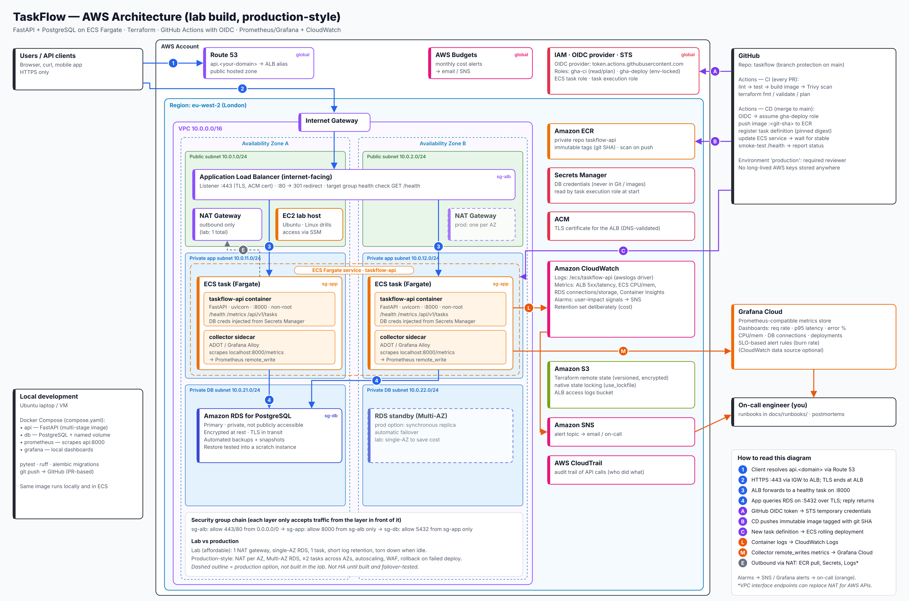

# TaskFlow — A Production-Grade AWS DevOps Platform

Task-management API (FastAPI + PostgreSQL) deployed to AWS ECS Fargate,
managed with Terraform and GitHub Actions (OIDC), observed with Prometheus,
Grafana and CloudWatch.

## Status
🚧 Phase 0 — repository foundation. See [learning progress](docs/learning-progress.md).
